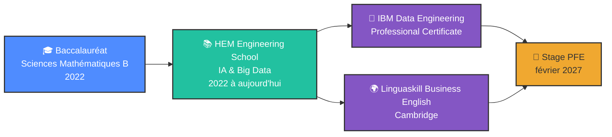

<div align="center">


<br/>

[](https://www.google.com/maps/place/Casablanca)
[](https://linkedin.com/in/inesskarim)
[](https://linkedin.com/in/inesskarim)

</div>

---

## 👩‍💻 Qui suis-je ?

<table>
<tr>
<td width="50%" valign="top">

### L'essentiel

```yaml
nom: Iness Karim
école: HEM Engineering School
formation: Ingénierie IA & Big Data (5e année)
ville: Casablanca, Maroc
objectif: Stage PFE de 6 mois, février 2027
domaines:
  - Data Engineering
  - MLOps
  - IA générative
langues:
  - Français: courant
  - Anglais: avancé
  - Espagnol: en apprentissage
```

</td>
<td width="50%" valign="top">

### Ce que je construis

```javascript
const iness = {
  jeConstruis: [
    "Pipelines ETL orchestrés",
    "Modèles de ML suivis et servis par API",
    "Applications avec des LLM",
    "Recherche vectorielle et cache sémantique"
  ],

  chaîne: "Données → Pipeline → Modèle → API",

  qualités: [
    "Autonomie", "Rigueur",
    "Esprit analytique", "Curiosité technologique"
  ]
};
```

</td>
</tr>
</table>

---

## 🛠️ Mes outils

<div align="center">

**IA & Data**


**Data Engineering & MLOps**


**Développement, web et API**


**Bases de données**


</div>

---

## 🚀 Projets

<div align="center">

<table>
<tr>
<td align="center" width="50%" valign="top">

### 📦 Pipeline ETL → ML


Prédiction des retards de livraison : 1,5 million de lignes, 44 tests dbt, 3 modèles comparés, **XGBoost AUC 0,794**, le tout lancé avec `docker compose up`.

**[Voir le projet →](https://github.com/iness-karim/pipeline-etl-ml)**

</td>
<td align="center" width="50%" valign="top">

### 🧠 Passerelle LLM


Proxy d'API LLM avec basculement automatique vers un modèle secondaire et **cache sémantique** par recherche vectorielle pour réduire latence et coûts.

**[Voir le projet →](https://github.com/iness-karim/llm-smart-gateway)**

</td>
</tr>
</table>


</div>

---

## 💼 Expérience

<details open>
<summary><b>🔍 Stage PFA : société de transport de marchandises (février à avril 2026, Casablanca)</b></summary>

<br/>

```yaml
réalisations:
  - Application web de gestion de flotte, de tournées et de chauffeurs :
    rôles, cartographie des itinéraires, bons de livraison générés en PDF
  - Architecture hybride : application Laravel + microservice d'IA en FastAPI
  - Modèle de prédiction du risque de retard : régression logistique comparée
    à un Random Forest (validation croisée, Grid Search)
  - Résultat sur 160 lignes de test : F1 de 0,70 contre 0,65 pour le Random Forest,
    modèle retenu pour son interprétabilité
  - Un LLM (Groq, Llama 3) transforme les prédictions en recommandations
    lisibles par les décideurs métier
```

**Stack :** `Laravel` `FastAPI` `Python` `PHP` `MySQL` `Docker` `Leaflet` `REST API` `Groq` `Llama 3`

</details>

---

## 🎓 Parcours

<div align="center">



</div>

**Centres d'intérêt :** apprentissage des langues · lecture · veille technologique

---

<div align="center">

## 📫 Travaillons ensemble

Je cherche un stage où mes pipelines et mes modèles tournent en production.

[](https://linkedin.com/in/inesskarim)


</div>
